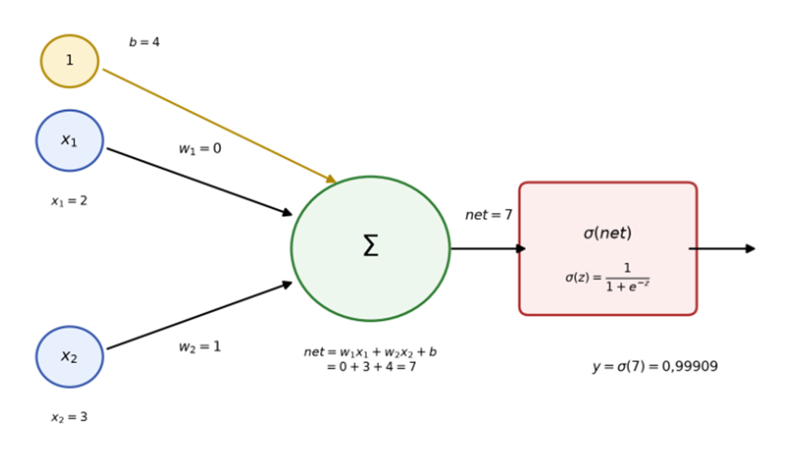

# Теоретические сведения

## Искусственный нейрон

**Искусственная нейронная сеть (ИНС)** — упрощённая модель биологической нейронной сети. Как и в мозге, она состоит из нейронов, взаимодействующих между собой.

Искусственный нейрон имеет несколько входов, принимает сигналы, преобразует их и передаёт другим нейронам. Другими словами, искусственный нейрон — это функция, преобразующая несколько входных параметров в один выходной.

У нейрона есть $n$ входов $x_1, x_2, \ldots, x_n$, у каждого из которых есть вес $w_i$, на который умножается проходящий сигнал.

Взвешенные сигналы направляются в сумматор, который агрегирует их во взвешенную сумму — **net**:

$$
net = \sum_{i=1}^{n} w_i x_i
$$

Передавать взвешенную сумму на выход «как есть» бессмысленно — нейрон должен её обработать. Для этого используют **функцию активации** $f$, преобразующую взвешенную сумму в число, которое и будет выходом нейрона:

$$
y = f(net)
$$

### Схемы искусственного нейрона

<strong>Архитектура искусственного нейрона</strong>

  

<strong>Схема устройства нейрона</strong>

# Создание искусственного нейрона

Реализован класс `Neuron`. С точки зрения теории это **один искусственный нейрон** — композиция линейного преобразования (сумматор + веса) и функции активации:

$$
net = w^T x + b,\quad y = \phi(net).
$$

В коде: `np.dot(self.weights, inputs) + self.bias` — это вычисление `net` (взвешенная сумма + смещение), `sigmoid(total)` — функция активации $\phi$.

Для $x = [2, 3],\ w = [0, 1],\ b = 4$:

$$
net = 2 \cdot 0 + 3 \cdot 1 + 4 = 7,
$$

$$
y = \sigma(7) = \frac{1}{1 + e^{-7}} = 0{,}9990889488055994.
$$

**Схема реализованного искусственного нейрона:**

